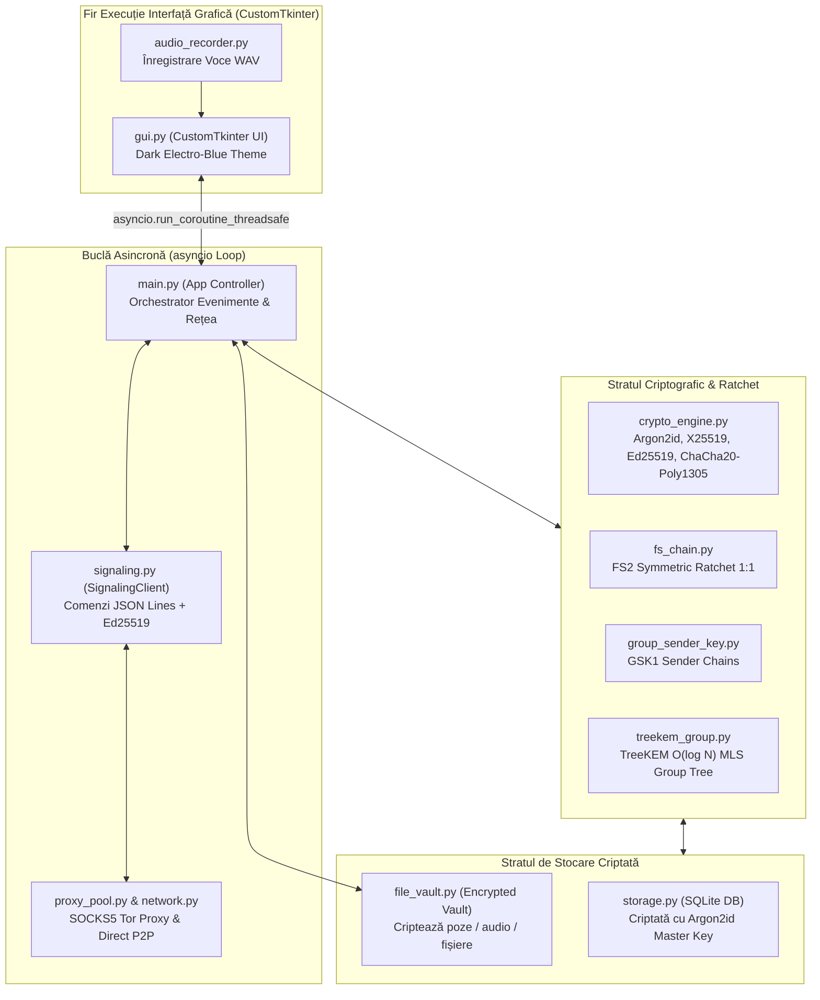
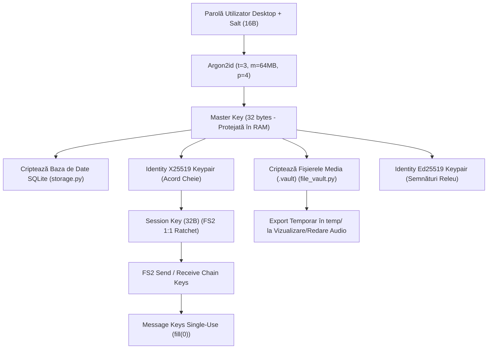
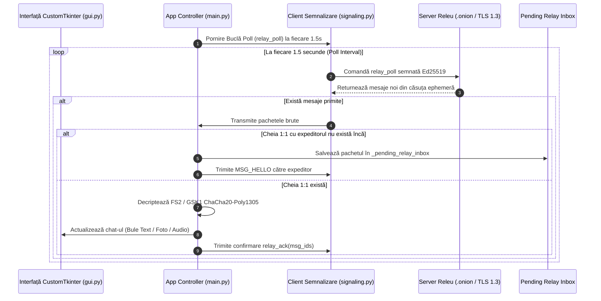
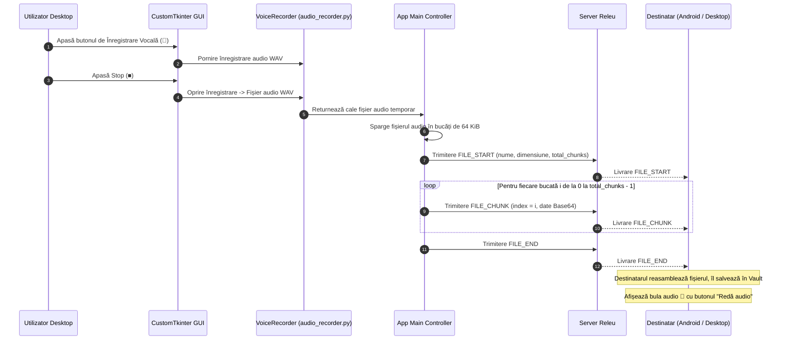
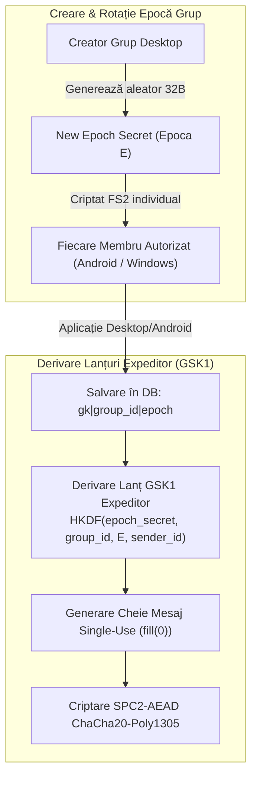

# Arhitectura Criptografică și Diagramarea Aplicației Desktop Python (SecureP2PChat)

Acest document reprezintă specificația tehnică oficială a aplicației **SecureP2PChat Desktop (Windows/Linux/macOS)** în Python. Conține toate diagramele **Mermaid** pentru modulele interne, bucla asincronă, stocarea în seiful criptat (Vault), transferurile media, interacțiunea cu releul și interoperabilitatea cu Android.

---

## 1. Arhitectura Modulilor Aplicației Desktop Python

 Diagrama de structură a modulelor din clientul Python și interacțiunea dintre interfața grafică (`CustomTkinter`), rețeaua asincronă (`asyncio`), motorul criptografic și baza de date criptată.

---

## 2. Arborele Ierarhic al Cheilor și Stocarea Locală (Storage & Vault)

 Cum derivă aplicația desktop cheia Master din parola utilizatorului pentru a proteja baza de date locală SQLite și fișierele din seiful criptat (`.vault`):

---

## 3. Bucla Asincronă de Rețea și Sondarea Releului (Relay Poll Loop)

 Sincronizarea asincronă între interfața grafică și serverul de semnalizare prin polling anonim Tor v3:

---

## 4. Transferul și Redarea Mesajelor Vocale și Imagini în Interfață

 Fluxul complet de la înregistrarea audio / selectarea imaginii pe desktop, fragmentarea în bucăți de 64 KiB, până la recepție, decriptare și redare:

---

## 5. Criptografia în Grupuri Desktop (GSK1 & Epoch Key Distribution)

 Cum funcționează sincronizarea cheilor de grup pe desktop la alăturarea sau trimiterea mesajelor de către utilizatorii Windows/Android:

---

## 6. Interoperabilitatea Completă Android ── Windows Python

 Trecerea datelor între cele două stive tehnologice prin protocolul binar/JSON unificat:

```mermaid
flowchart LR
    subgraph StivaAndroid ["Client Android (Kotlin)"]
        AndroidCore["ChatManager.kt / Protocol.kt"]
        AndroidCrypto["ForwardSecrecyChain.kt / GroupSenderKeyChain.kt"]
    end

    subgraph ProtocolUnificat ["Protocol Binar & JSON Lines"]
        FS2Header["Header FS2: 'FS2' (3B) + SessionID (16B) + Counter (4B)"]
        GSK1Header["Header GSK1: 'GSK1' + Epoch (8B) + Counter (4B)"]
        FileChunks["Bucăți Fișiere: 64 KiB per Chunk"]
    end

    subgraph StivaWindows ["Client Windows (Python)"]
        PyMain["client/main.py / shared/protocol.py"]
        PyCrypto["client/fs_chain.py / client/group_sender_key.py"]
    end

    StivaAndroid <-->|Pachete Binar/JSON Criptate| ProtocolUnificat
    ProtocolUnificat <-->|Pachete Binar/JSON Criptate| StivaWindows
```

---

## 7. Specificația Modulilor Sursă Desktop

| Fișier Sursă Python | Linii Cod | Funcție Principală și Detalii Criptografice |
| :--- | :--- | :--- |
| `client/main.py` | ~2970 | **Controller Principal**: Buclă asincronă, gestiune stare chat, `_pending_relay_inbox`, flushes. |
| `client/gui.py` | ~1030 | **Interfață CustomTkinter**: Bule chat, previzualizare poze, player audio, picker fișiere. |
| `client/crypto_engine.py` | ~150 | **Criptografie Bază**: Argon2id, X25519, Ed25519, ChaCha20-Poly1305 (plic `SPC2`), HSalsa20. |
| `client/fs_chain.py` | ~150 | **Ratchet 1:1 (FS2)**: Lanț simetric per direcție, HKDF-SHA256, fereastră skip max 1024. |
| `client/group_sender_key.py`| ~120 | **Ratchet Grup (GSK1)**: Derivare lanț expeditor din `epoch_secret` și zeroizare RAM (`fill(0)`). |
| `client/treekem_group.py` | ~350 | **MLS Group Tree**: Arbore logaritmic TreeKEM $O(\log N)$ pentru re-cheierea grupurilor mari. |
| `client/storage.py` | ~670 | **Stocare SQLite Criptată**: Protecție cu Argon2id Master Key a contactelor și stărilor ratchet. |
| `client/file_vault.py` | ~50 | **Seif Fișiere**: Salvarea criptată `.vault` a pozelor, audio-ului și atașamentelor pe disc. |
| `client/audio_recorder.py` | ~60 | **Înregistrare Voce**: Înregistrare audio din microfon în fișiere temporare WAV. |
| `signaling_server.py` | ~840 | **Server Releu**: Server hibrid anonim, verificări Ed25519, cozi de mesaje ephemere în RAM. |
